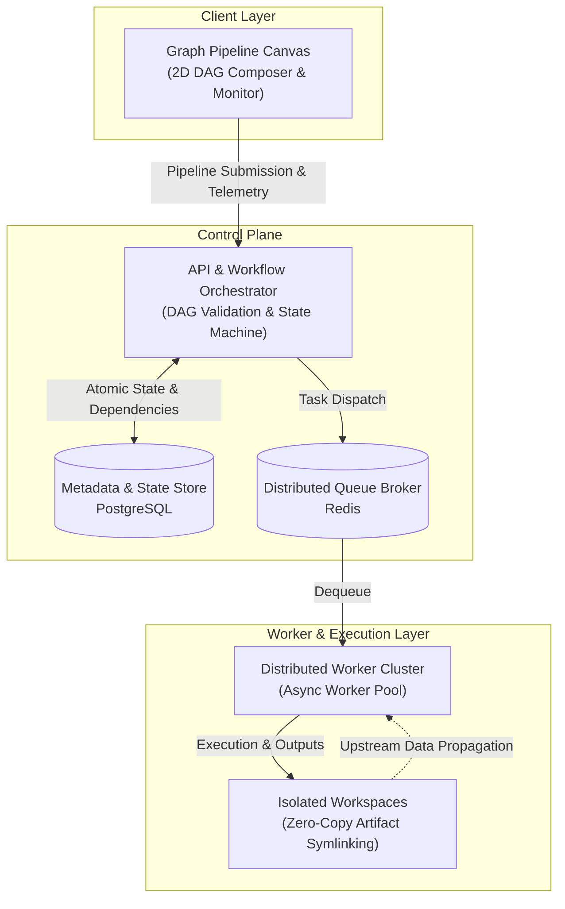

# AtomField

> **Distributed graph-based pipeline orchestrator and task execution infrastructure for high-throughput computational workloads.**

AtomField provides a resilient, HPC-inspired workflow orchestration platform. It enables users to compose directed acyclic graph (DAG) pipelines, schedule asynchronous computational tasks, resolve multi-node dependency barriers, and manage isolated execution workspaces.

---

## Architecture

Modeled after modern distributed workload managers and HPC schedulers, AtomField decouples pipeline authoring, state management, queue scheduling, and compute execution into dedicated layers.

---

## Core Capabilities

- **Graph-Based Pipeline Orchestration**: Submits arbitrary DAG workflows with automated root-node discovery, topological sequencing, and dynamic fan-in barrier evaluation.
- **HPC-Style Workspace Isolation**: Automatically generates isolated execution directories per task, with zero-copy symlinking of upstream dependencies (`upstream/job_<id>/`).
- **Distributed Asynchronous Task Execution**: High-throughput task dispatching, concurrency control, failure propagation, and live log streaming across background worker nodes.
- **Visual DAG Authoring**: Interactive node canvas for real-time workflow composition, parameter configuration, execution status tracking, and artifact inspection.

---

## Tech Stack

| Component | Technologies |
| :--- | :--- |
| **Pipeline UI** | React, TypeScript, React Flow, Vite, Tailwind CSS |
| **Control Plane** | Python 3.11+, FastAPI, SQLAlchemy (Async), Asyncpg |
| **Queue & Scheduling** | Redis, ARQ (Distributed Task Queue) |
| **State & Persistence** | PostgreSQL, ACID transaction locking |
| **Execution Environment** | Isolated POSIX workspaces, Docker container sandboxing |

---

## Proprietary Notice

This software is proprietary and confidential to **AtomField Labs**. Unauthorized copying, distribution, or commercial modification of this codebase is strictly prohibited.
